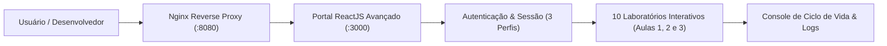

<div align="center">

  <h1>⚛️ ReactJS Avançado — Portal Interativo & Arquitetura (DIO)</h1>

  <div>
    
    
    
    
    
    
    
    
    
    
    
  </div>

  <br />

  <div>
    
    
    
    
    
    
  </div>

</div>

---

## 📝 Descrição

<cite>Repositório oficial de estudos práticos do Curso Avançado de ReactJS da Digital Innovation One (DIO), consolidado em um Portal Interativo unificado com autenticação por perfis, telemetria em tempo real e 10 laboratórios práticos abordando Ciclo de Vida, Hooks, Context API, Fragments, Error Boundaries, Render Props, Type Checking (PropTypes), Refs & DOM, Smart/Dumb Components e Arquitetura Escalável de Projetos.</cite>

---

## 📊 Status do Projeto

- ✅ **Portal Unificado na Raiz (`src/` e `public/`)** com tela de Login, controle de sessão e 10 laboratórios interativos
- ✅ **10 Subprojetos Modulares Revisados e Estabilizados** (Aulas 1, 2 e 3)
- ✅ **Infraestrutura Docker Multi-Stage Otimizada** (`app`, `nginx`, `mysql`, `phpmyadmin`)
- ✅ **Documentação Técnica e Roteiros de Testes Padronizados** em `./docs/`

---

## 🏗️ Arquitetura do Sistema

O projeto é estruturado em duas camadas complementares:

1. **Portal Interativo Unificado (`./src`)**: Aplicação SPA em React que integra autenticação com persistência em `localStorage`, gerenciamento global de tema/token via `Context API`, console de telemetria de ciclo de vida e simuladores ao vivo para cada padrão arquitetural do curso.
2. **Laboratórios Modulares Independentes (`./life-cycle`, `./hooks`, `./context-api`, etc.)**: Subprojetos individuais organizados por aula, permitindo estudar e executar cada conceito isoladamente.



---

## 📋 Pré-requisitos

Para executar o projeto localmente ou via containers, certifique-se de possuir:

- **Node.js** `>= 18.x` (Ambiente de referência: `22.14.0` com `NODE_OPTIONS=--openssl-legacy-provider`)
- **NPM** `>= 9.x` (Ambiente de referência: `11.4.2`) ou **Yarn** `>= 1.22`
- **Docker** `>= 24.0` e **Docker Compose** `>= 2.20` *(para execução containerizada)*
- **Laragon** `6.0.0` *(opcional, para execução local padronizada)*
- **Git** `>= 2.40`

---

## 🛠️ Tecnologias Utilizadas

| Categoria | Tecnologia | Versão | Finalidade |
| :--- | :--- | :--- | :--- |
| **Frontend Library** | React / React DOM | `^17.0.2` | Construção declarativa de interfaces e componentes |
| **Build & Tooling** | Create React App (`react-scripts`) | `4.0.3` | Empacotamento Webpack, Babel e servidor de desenvolvimento |
| **Type Validation** | PropTypes | `^15.7.2` | Checagem estática e em tempo de execução das props |
| **Testes Unitários** | Jest + React Testing Library | `^11.1.0` | Testes de renderização, eventos de usuário e utilitários |
| **Servidor Web / Proxy** | Nginx | `1.27-alpine` | Reverse proxy com compressão Gzip e endpoint `/api/health` |
| **Containerização** | Docker & Docker Compose | Multi-stage | Isolamento de build (`node:20-alpine`) e orquestração de serviços |
| **Banco & Gestão** | MySQL 8.0 + phpMyAdmin | `8.0` / `latest` | Infraestrutura de apoio padronizada nas portas `3308` e `8085` |

---

## ✨ Funcionalidades

- 🔐 **Autenticação e Sessão com 3 Perfis de Demonstração**: Login completo com validação de credenciais, botões de preenchimento rápido em **1 clique** (*Administrador*, *Instrutor* e *Aluno*), persistência via `localStorage` e botão de **Sair (Logout)**.
- 🌓 **Gerenciamento Global com Context API**: Alternância instantânea entre tema Escuro e Claro e simulação de concessão/revogação de token de autenticação (`./context-api`).
- 🔄 **Simulador de Ciclo de Vida e React Hooks**: Inspeção visual de `componentDidMount`, `componentDidUpdate`, `componentWillUnmount`, `useState`, `useEffect` e `React.memo` (`./life-cycle` e `./hooks`).
- 🛡️ **Tratamento Resiliente de Falhas com Error Boundaries**: Captura de erros em componentes filhos com `componentDidCatch` e exibição de Fallback UI com botão de restauração a quente (`./error-boundaries`).
- 🧩 **Padrões de Composição e Reutilização**: Demonstrações práticas de `<React.Fragment>` em tabelas HTML válidas (`./fragments`), compartilhamento de estado via **Render Props** (`./render-props`) e validação com **PropTypes** (`./type-checking`).
- 🎯 **Manipulação Imperativa com Refs & DOM**: Controle direto de foco (`inputRef.current.focus()`) e contadores mutáveis com `useRef` (`./refs-dom`).
- 🏛️ **Separação Smart & Dumb Components e Estrutura Escalável**: Calculadora desacoplada (`Calc`), galeria interativa (`PhotosGallery`) e organização em `commons`, `components`, `containers`, `resources` e `routes` (`./dumb-components`, `./smart-components`, `./structure-project`).

---

## 📖 Sobre o Projeto

Este repositório foi desenvolvido durante o **Curso Avançado de ReactJS da Digital Innovation One (DIO)** e aprimorado com uma arquitetura unificada para servir como catálogo vivo de boas práticas em React.

### Divisão Pedagógica das Aulas
- **Aula 1️⃣ — Fundamentos Avançados de Estado e Ciclo de Vida**:
  - [Ciclo de Vida (`./life-cycle`)](./life-cycle)
  - [Hooks (`./hooks`)](./hooks)
  - [Context API (`./context-api`)](./context-api)
- **Aula 2️⃣ — Composição, Resiliência, Tipagem e DOM**:
  - [Fragmentos (`./fragments`)](./fragments)
  - [Error Boundaries (`./error-boundaries`)](./error-boundaries)
  - [Render Props (`./render-props`)](./render-props)
  - [Type Checking (`./type-checking`)](./type-checking)
  - [Refs & DOM (`./refs-dom`)](./refs-dom)
- **Aula 3️⃣ — Componentização e Arquitetura de Projetos**:
  - [Dumb Components (`./dumb-components`)](./dumb-components)
  - [Smart Components (`./smart-components`)](./smart-components)
  - [Estrutura de Projeto (`./structure-project`)](./structure-project)

---

## 🖥️ Preview

Ao iniciar a aplicação (`http://localhost:3000` localmente ou `http://localhost:8080` via Docker), você terá acesso imediato à tela de login com **Acesso Rápido em 1 Clique** para os perfis de **Administrador**, **Instrutor** e **Aluno**, seguido pelo Dashboard com navegação lateral entre os 10 módulos e o Console de Telemetria em tempo real.

---

## 📚 Documentação do Projeto

Toda a documentação operacional, guias de execução e credenciais de teste estão centralizados na pasta [`./docs`](./docs):

- 📘 [**Como Executar (Visão Geral)**](./docs/COMO_EXECUTAR.md) — Escolha entre execução Local ou Docker e veja como alternar o `.env`.
- 💻 [**Como Executar Localmente**](./docs/COMO_EXECUTAR_LOCAL.md) — Passo a passo completo no host local e tabela de Ambiente de Referência.
- 🐳 [**Como Executar via Docker**](./docs/COMO_EXECUTAR_DOCKER.md) — Arquitetura de containers (`app`, `nginx`, `mysql`, `phpmyadmin`) e portas padronizadas.
- 🔐 [**Guia de Acessos e Testes**](./docs/ACESSOS_TESTES.md) — URLs, credenciais dos 3 perfis de demonstração e roteiro de validação dos 10 módulos.

---

## 💻 Comandos

> [!IMPORTANT]
> Para instruções detalhadas de configuração do `.env` (alternância entre os blocos `# LOCAL` e `# DOCKER`) e resolução de problemas, consulte o guia oficial em [**docs/COMO_EXECUTAR.md**](./docs/COMO_EXECUTAR.md).

```bash
# 1. Copiar variáveis de ambiente
cp .env.example .env

# 2. Executar com Docker (Recomendado — Porta 8080)
docker compose up -d --build

# 3. Ou executar Localmente (Porta 3000)
npm install --legacy-peer-deps
NODE_OPTIONS=--openssl-legacy-provider npm start

# 4. Executar a suíte de testes automatizados
NODE_OPTIONS=--openssl-legacy-provider npm test -- --watchAll=false
```

---

## 📁 Estrutura do Projeto

```text
reactJs-avancado/
├── context-api/             # Módulo Aula 1: Gerenciamento de estado e tema com Context API
├── dumb-components/         # Módulo Aula 3: Componentes puramente apresentacionais (Button, Calc)
├── error-boundaries/        # Módulo Aula 2: Captura de erros com componentDidCatch
├── fragments/               # Módulo Aula 2: Uso de React.Fragment sem nós extras no DOM
├── hooks/                   # Módulo Aula 1: Ciclo de vida funcional com useState, useEffect e memo
├── life-cycle/              # Módulo Aula 1: Métodos de ciclo de vida em Class Components
├── refs-dom/                # Módulo Aula 2: Manipulação imperativa de foco e referências mutáveis
├── render-props/            # Módulo Aula 2: Compartilhamento de lógica via prop render
├── smart-components/        # Módulo Aula 3: Componentes com estado próprio (PhotosGallery)
├── structure-project/       # Módulo Aula 3: Organização escalável (commons, components, routes)
├── type-checking/           # Módulo Aula 2: Validação de propriedades com PropTypes e defaultProps
├── docker/                  # Configurações do Nginx (default.conf) e script de inicialização
│   ├── nginx/default.conf
│   └── scripts/start-app.sh
├── docs/                    # Documentação técnica padronizada
│   ├── ACESSOS_TESTES.md
│   ├── COMO_EXECUTAR.md
│   ├── COMO_EXECUTAR_DOCKER.md
│   └── COMO_EXECUTAR_LOCAL.md
├── public/                  # Template HTML e assets estáticos do Portal Unificado
├── src/                     # Código-fonte do Portal Interativo (Login, Sessão e 10 Laboratórios)
├── .dockerignore            # Exclusões de contexto de build Docker
├── .env.example             # Template de variáveis de ambiente (Blocos LOCAL e DOCKER)
├── Dockerfile               # Build Multi-stage otimizado (node:20-alpine)
├── docker-compose.yml       # Orquestração de app, nginx (8080), mysql (3308) e phpmyadmin (8085)
├── package.json             # Dependências e scripts da aplicação principal
└── README.md                # Documentação principal do repositório
```

---

## 🚀 Melhorias Futuras

- [ ] Migração opcional do bundler legado (`react-scripts` 4) para **Vite** mantendo compatibilidade com os exemplos clássicos do React 17/18.
- [ ] Persistência em banco de dados do progresso individual de cada aluno nos 10 módulos.
- [ ] Exportação de relatórios de telemetria e cobertura de testes (`coverage`) diretamente pela interface do portal.

---

<div align="center">
  Feito com ❤️ por Gabriel Martins 🚀
</div>
